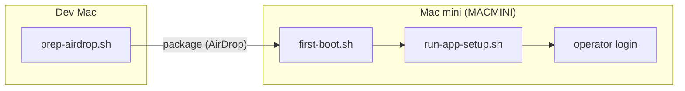
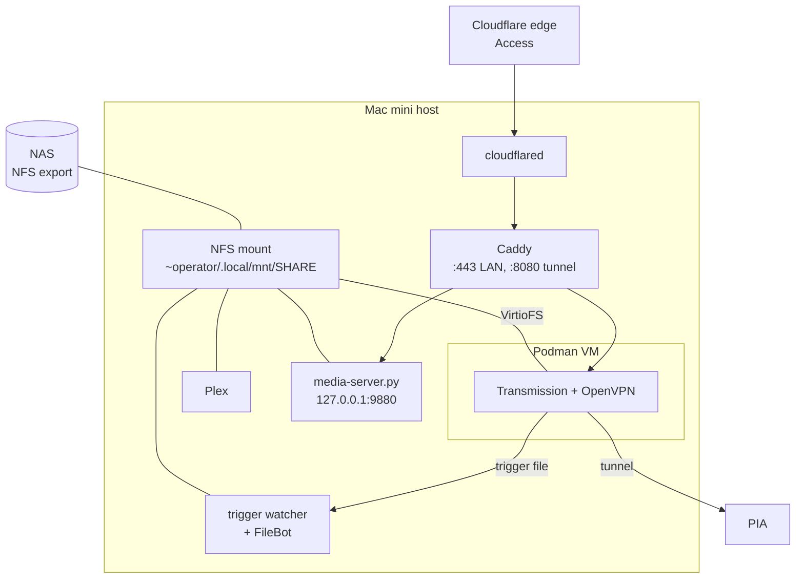

# Architecture

The server is a Mac mini that runs Plex for media on a NAS, with optional parts around it: a download pipeline behind a VPN, a Caddy web front end, a Cloudflare Tunnel for remote access, and watchdogs that send email. This page explains how setup is split into phases, why there are two accounts, how launchd runs each part, and why Transmission runs in a container.

## Three phases on two machines

Setup runs in three phases. Each phase runs where it has what it needs.

1. **`prep-airdrop.sh` on the dev Mac.** The dev Mac has the 1Password CLI, the SSH keys and the repository. The script reads secrets from 1Password once, puts them in a package keychain, and builds a setup package. The Mac mini never needs a 1Password session. See [Credential chain](credential-chain.md).
2. **`first-boot.sh` on the Mac mini.** It runs in a local GUI session as `admin`, because several steps need the GUI and cannot run over SSH. It checks the package's hardware fingerprint, creates the `operator` account, sets up automatic login, imports the credentials, installs Homebrew and the packages, and sets system preferences.
3. **`run-app-setup.sh` on the Mac mini.** It runs every `*-setup.sh` script in `app-setup/`. Seven known scripts run in a fixed dependency order (rclone, Podman Transmission, FileBot, Catch, Plex, Caddy, Cloudflare DDNS), and any other setup script runs after them. Only `caddy-setup.sh` and `cloudflare-ddns-setup.sh` run under `sudo` from the orchestrator. Some other scripts, such as `cloudflared-setup.sh`, must run as root, so you run them by hand as their component pages describe.

Every script is idempotent. A failed run is fixed by correcting the cause and running the same script again, not by a separate repair procedure.

The split keeps secrets and network access to 1Password on the dev Mac, keeps the GUI-only steps at the Mac mini, and lets the application layer change without a full reprovision. The get-started tutorial walks through the phases: [Build the setup package](../get-started/04-build-package.md), [Run first boot](../get-started/05-first-boot.md), and [Run app setup](../get-started/06-run-app-setup.md).

## Two accounts: admin and operator

| Account | Role | Logs in |
| --- | --- | --- |
| `admin` | Administrator. Runs setup, owns Homebrew, uses `sudo`. | By hand, for maintenance |
| `operator` | Standard account. Runs the media apps and the watchdogs. | Automatically at boot |

The reasons for the split:

- **The apps need a logged-in user.** Plex, the Podman VM and the macOS privacy (TCC) grants all belong to a GUI session. After a power cut the server must come back without a person at the keyboard, so one account logs in automatically. That account should not be an administrator.
- **Automatic login has a cost.** It needs FileVault off, and `first-boot.sh` checks for that. An account that logs in with no password should have as few rights as possible, and `operator` does not need `sudo` for daily work.
- **Homebrew belongs to one user.** Homebrew refuses to run as root and expects one owner. `admin` owns it. Setup scripts that run as root drop to the invoking user for `brew install`.
- **Limited damage.** A compromise of an app that runs as `operator` does not give administrator rights directly.

`first-boot.sh` creates `operator` with `sysadminctl` and passes the administrator credentials so that the account gets a SecureToken. Without a SecureToken, the Passwords app rejects the correct password for the account. See [`first-boot.sh`](https://github.com/smartwatermelon/mac-server-setup/blob/main/scripts/server/first-boot.sh).

## LaunchAgents and LaunchDaemons

launchd runs every long-running part. The choice between an agent and a daemon follows from what the part needs.

| Kind | Runs as | Starts | Used for |
| --- | --- | --- | --- |
| LaunchDaemon (`/Library/LaunchDaemons`) | root, or a named user | At boot, before any login | Caddy, cloudflared, Cloudflare DDNS, the media file server |
| LaunchAgent (`~operator/Library/LaunchAgents`) | `operator` | At `operator` login | Plex, the NAS mount, the Podman VM supervisor, the FileBot trigger watcher, the watchdogs |

A part is a **daemon** when it must start at boot as root, for example to read the System keychain, and does not need a GUI session. Caddy and the Cloudflare DDNS updater read the Cloudflare API token from the System keychain. cloudflared reads the tunnel token from the same keychain. The media file server is a daemon that runs as `operator` (`UserName` in its plist): the Caddy daemon runs as root, and root got `EPERM` from the NFS mount, so Caddy proxies `/media/` to this separate process.

A part is an **agent** when it needs the `operator` session. Plex is a GUI application. The Podman VM and its file sharing depend on privacy grants that macOS keeps per user. The watchdogs send mail with msmtp, and msmtp refuses a config file with a password in it unless the invoking user owns that file. A root daemon could read the tokens but could not send the alert, so the watchdogs run as `operator` agents. See [Monitoring](../components/monitoring.md).

Two launchd behaviors shape the scripts:

- **launchd's PATH has no Homebrew.** Agents start with `PATH=/usr/bin:/bin:/usr/sbin:/sbin` and run `/bin/bash`, which is bash 3.2. Each script sets its own PATH, and the watchdog code stays bash 3.2 compatible. Until 2026-09 every watchdog email failed silently because a bare `msmtp` was not on that PATH.
- **An agent that exits takes its children with it.** When a LaunchAgent's script exits, launchd removes the agent's resource coalition, and the Podman VM process (`vfkit`) shuts down about five seconds later. The Podman supervisor, `podman-machine-start.sh`, therefore never exits. It starts the VM and the container, then loops on health checks. See the comment at the top of the supervisor in [`podman-transmission-setup.sh`](https://github.com/smartwatermelon/mac-server-setup/blob/main/app-setup/podman-transmission-setup.sh).

## Why Transmission runs in Podman behind PIA

Downloads must leave the house only through the VPN. Plex must not; it needs the normal internet connection for remote play and metadata.

The first design ran the native Transmission app with PIA Desktop's split tunnel and a monitor script that stopped Transmission when the VPN dropped. That design enforced the VPN in the application layer, and it had races: a monitor that polls can leave Transmission unguarded for a few seconds, and the macOS split-tunnel mechanism asked for consent in dialogs that an unattended server cannot answer. The split tunnel then stopped passing traffic altogether on a macOS update.

The current design moves the boundary into a Linux network namespace:

- Podman runs a rootful Linux VM, `transmission-vm`, owned by `operator`.
- One container, `haugene/transmission-openvpn`, holds OpenVPN, Transmission and PIA port forwarding. The image's kill switch drops traffic that does not go through the tunnel. If the tunnel drops, packets stop at the kernel. No polling script decides.
- The Transmission web UI publishes on `127.0.0.1:9091` only. Caddy proxies it.
- Plex, FileBot and the rest stay on the host and use the normal network.

The container cannot run macOS programs, so a trigger file connects it to FileBot. When a download completes, the container writes a file into a shared directory. The trigger watcher, an `operator` agent on the host, finds it, maps the container path to the host path, and runs `transmission-done`, which runs FileBot and asks Plex to scan. See [Transmission and FileBot](../components/transmission-filebot.md) and [PIA VPN](../components/pia-vpn.md).

The container uses PIA's port forwarding through its own manager, not the image's updater. The image's updater sets Transmission's listen port to 0 when port forwarding fails, which stops all downloads. The repo's manager refuses a bad port and keeps the old one.

## How the parts connect

- The host mounts the NAS once, over NFS. Plex, FileBot and the media file server read it there. The container sees the same mount through VirtioFS. See [Storage and VirtioFS](storage-virtiofs.md).
- Caddy serves the dashboard and proxies Transmission and the media file server. On the LAN it uses its own CA. See [TLS strategy](tls-strategy.md).
- Remote access goes through Cloudflare Access and a tunnel to a loopback-only Caddy site. No inbound port is open. See [Tunnel security layers](tunnel-security-layers.md).
- The watchdogs poll Plex, port forwarding, the tunnel, the Access policy and stalled privacy prompts, and send email on a change of state. See [Monitoring](../components/monitoring.md).

Which parts you install is your choice. The [stack matrix](../stack-matrix.md) lists what each part depends on.
