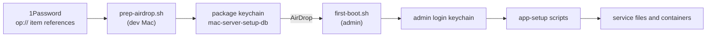

# Credential chain

The server needs passwords and tokens: the `operator` account password, NAS and Time Machine logins, the PIA VPN account, Wi-Fi, and Cloudflare tokens. This page explains where each secret starts, how it moves to the service that uses it, and why long-running services take secrets from the environment, a file or stdin, and not from the command line.

## Two chains, not one

Secrets reach the server by two routes.

| Chain | Secrets | Source | Lands in |
| --- | --- | --- | --- |
| Package chain | `operator` password, NAS, Time Machine, Wi-Fi, OpenSubtitles, PIA | 1Password, read on the dev Mac | The `admin` login keychain |
| System keychain chain | Cloudflare API token, tunnel token, read-only Access token | You type each one at a prompt on the server | `/Library/Keychains/System.keychain` |

The package chain exists because first boot runs before the Mac mini has any account that could sign in to 1Password. The System keychain chain exists because root daemons read those tokens, and the System keychain is the keychain that root reads without a GUI session.

## The package chain

1. **1Password.** It is the source of truth. `prep-airdrop.sh` reads each item with `op read` on the dev Mac. A rotation starts here.
2. **The package keychain.** `prep-airdrop.sh` creates a keychain named `mac-server-setup`, stores each secret in it, reads each one back to check it, locks the keychain, and copies the file into the package as `config/mac-server-setup-db`. Service names follow the pattern `<purpose>-<server name>`, for example `pia-account-macmini`. A login and password pair is stored as one `username:password` string.
3. **First boot import.** `first-boot.sh` unlocks the package keychain and copies each item into the `admin` user's default keychain, which is the login keychain. An optional item that is missing gives a warning, not an error.
4. **App setup.** Each setup script reads what it needs from the `admin` keychain and writes it into the form its service uses. For example, `podman-transmission-setup.sh` writes the PIA account to `~operator/containers/transmission/.env` with mode 600.
5. **Runtime.** The service reads its own file. It does not read a keychain at run time. The secrets sit in the `admin` keychain, and the services run as `operator`, which cannot read it.

### What protects the package keychain

The package keychain's password is the dev Mac's hardware UUID. `prep-airdrop.sh` writes that password into `config/keychain_manifest.conf` in the same package, with mode 600. The keychain therefore keeps secrets out of plain-text config files and lets `security` check each value, but anyone who has the whole package can open it. Treat the whole package as a secret. `first-boot.sh` copies the package keychain into the `admin` keychain folder and keeps the original, so that a second run works. The setup scripts have no step that deletes either copy.

The hardware fingerprint has a second use. `first-boot.sh` refuses to run on the machine that built the package, which stops a mistaken run on the dev Mac.

## The System keychain chain

Root daemons read the Cloudflare tokens from the System keychain each time they start. The pattern is the same for each one: a small wrapper reads the token, exports it to an environment variable, and uses `exec` to start the real program.

| Token | Read by | Passed on as |
| --- | --- | --- |
| `cloudflare-api-token` | `caddy-wrapper.sh` and the DDNS updater (root) | `CF_API_TOKEN` environment variable |
| `cloudflare-tunnel-token` | `cloudflared-wrapper.sh` (root) | `TUNNEL_TOKEN` environment variable |
| `cloudflare-access-readonly-token` | `access-policy-watchdog-setup.sh` (root, at deploy) | A mode 600 file that `operator` owns |

The read-only Access token goes to a file because the drift watchdog runs as `operator`, which cannot read the System keychain. The setup script writes the file through a shell redirect into a file created with `umask 077`, so the token is never an argument. The token can only read Access and tunnel configuration. See [Tunnel security layers](tunnel-security-layers.md).

Do not use `cloudflared service install <token>`. It writes the token into a LaunchDaemon plist, and those files are readable by every user.

## Why long-running services keep secrets off argv

On macOS, `ps` shows the full argument list of every process to every user. A secret on a command line is visible to any account on the machine for as long as that process runs. Environment variables of another user's process are not shown that way, and a file with mode 600 is readable only by its owner.

The long-running parts follow these rules:

- **Wrappers export and exec.** `caddy-wrapper.sh` and `cloudflared-wrapper.sh` put the token in the environment and replace themselves with the real program. `cloudflared tunnel run` takes no token argument.
- **curl reads headers from stdin.** The drift watchdog sends `Authorization: Bearer ...` to `curl -K -` through a pipe from `printf`, which is a shell builtin and so is not a separate process.
- **Containers get an env file.** The Transmission container is created with `--env-file`, not `-e PIA_PASSWORD=...`. Because `--env-file` is read only when the container is created, a password change needs a container recreate, not a restart.
- **People type secrets at a prompt.** To add a keychain item by hand, give `security add-generic-password` the `-w` flag with no value, as the last argument, so it prompts. The value is then not in shell history or the process list. If a keychain path follows a bare `-w`, `security` can take the path as the password.

### Where the rule does not hold yet

Some commands still pass secrets as arguments. While each one runs, any local account can see the value with `ps`.

At setup time, for a few seconds each:

- `prep-airdrop.sh` and `first-boot.sh` call `security add-generic-password -w "<value>"` and `security create-keychain -p`.
- `first-boot.sh` passes the `operator` and `admin` passwords to `sysadminctl` as arguments.
- The hint that `cloudflare-ddns-setup.sh` prints, when the token is missing, puts the token on the `security` command line.

After setup:

- The PIA port manager inside the container passes the PIA account to `curl` as arguments, each time it asks for a port-forwarding token, for as long as the container runs.
- The PIA port-forwarding probe, which you run when you need it, passes the account to `podman exec -e` and to `curl`.

See [PIA VPN](../apps/pia-vpn-README.md).

## Rotating a secret

A rotation must go through every stage that holds a copy, in order. For a package-chain secret: change it at the provider, update 1Password, update the `admin` keychain item on the server, then run the setup script again so that it rewrites the service file. For the PIA account, the container must then be recreated. [PIA VPN](../apps/pia-vpn-README.md) gives the full procedure. For a System keychain token, replace the keychain item and restart the daemon that reads it.

For the older description of the keychain format and service names, see [Keychain credential management](../keychain-credential-management.md).
