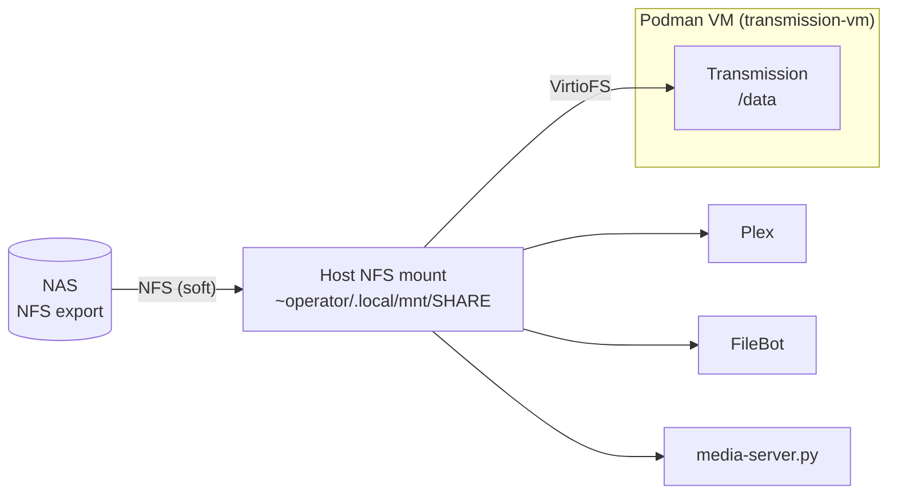

# Storage and VirtioFS

All media lives on a NAS. The Mac mini mounts it once, over NFS, and every consumer reads that one mount: Plex, FileBot, the media file server, and the Transmission container inside the Podman VM. This page explains why the storage path has this shape, why the container's incomplete directory is off, and why macOS privacy grants need binaries with a stable signature.

## One host mount, shared through VirtioFS

The host mounts the share with `mount_nfs` from `mount-nas-media.sh`, which an `operator` LaunchAgent runs every 120 seconds. If the mount table already shows the NFS mount, the script stops. If not, it clears the mount point and mounts the share again. NFS uses host-based authentication, so the script holds no NAS password.

The container does not mount NFS itself. Podman passes the host mount into the VM over VirtioFS, and the container sees it as `/data`. An earlier design mounted NFS inside the VM. It was dropped because the VM's NAT network lost TCP connections to LAN hosts at random times while ICMP still worked, and the in-VM mount then failed with "Permission denied". The host mount, with its own retry agent, has been reliable. The plan that records this change is [Revert to VirtioFS](../plans/2026-03-28-revert-to-virtiofs.md).

The Podman supervisor protects this path in two ways:

- **It waits for the mount.** Before it starts the VM, it waits up to 120 seconds for the NFS mount. A VM that starts first shares an empty directory.
- **It checks `/data`.** Each pass of its loop lists `/data` inside the container. After three failures in a row, it removes the container, stops the VM, and starts both again, which gives VirtioFS fresh handles to the NFS mount.

The supervisor's recovery cycles the VM and the container. It leaves the host mount alone, because Plex reads the same mount and would lose its media.

NAS-side settings, such as the NFS squash rule and directory permissions, are in [Transmission and FileBot](../apps/transmission-filebot-README.md).

## Why the incomplete directory is off

Transmission can write a download in progress to an incomplete directory and move it to the download directory when it completes. The container sets `TRANSMISSION_INCOMPLETE_DIR_ENABLED=false`, so every download is written in place under `pending-move/`.

The move from one directory to another is a rename across directories. On this storage path, that rename goes through VirtioFS to a `soft` NFS mount. With the incomplete directory on, completed downloads were lost: the files were gone from the source and never appeared at the destination. The probable cause is that VirtioFS reported the rename as a success while the NFS call underneath failed. A `soft` mount returns an error after a timeout, where a `hard` mount would retry. The repository records the setting, not a proof of this mechanism.

With the incomplete directory off, the only rename is in one directory: Transmission writes `<name>.part` and removes the `.part` suffix when the file completes. That change had a side effect. The hourly `pending-move-cleanup.sh` sweep deletes entries that are not in Transmission's torrent list, and a file named `<name>.part` did not match its torrent name, so the sweep deleted downloads that were still in progress. The sweep now compares names with the `.part` suffix removed, and [`tests/pending-move-cleanup.bats`](https://github.com/smartwatermelon/mac-server-setup/blob/main/tests/pending-move-cleanup.bats) covers that case.

## macOS privacy grants for network volumes

macOS checks privacy (TCC) grants before a process reads a network volume. On this server two different checks have been observed.

- **Network volume grant.** `kTCCServiceSystemPolicyNetworkVolumes` shows the dialog "would like to access files on a network volume". It is kept per user, so the `operator` session owns it. The Podman supervisor and FileBot both stopped on this dialog until someone clicked Allow, once for 19 hours.
- **Full Disk Access.** The VirtioFS I/O is done by Apple's `com.apple.Virtualization.VirtualMachine` XPC service. When NFS handles expired after a long idle time, that service could no longer open directories on the mount (`opendir()` returned `EPERM`) until it had Full Disk Access. `/bin/bash`, used by the LaunchAgents, needed the same grant for the same reason.

The two component pages describe these grants differently. [Stable signing](../apps/stable-signing-README.md) says that Full Disk Access does not cover network volumes on macOS Tahoe. [Transmission and FileBot](../apps/transmission-filebot-README.md) describes Full Disk Access as the fix for the `opendir()` failure. Both are observations from the server, and they can both be true if the two failures come from different checks. Treat both grants as needed.

### Which binary gets the grant

An XPC service is not its own TCC client. macOS charges the access to a responsible process. On this server, the observed rule is: the first non-Apple binary below the LaunchAgent's `/bin/bash`. For the Podman supervisor that is `gtimeout` from coreutils, which runs `podman-remote`, which runs `vfkit`. For FileBot it is Homebrew `bash`, because `transmission-done` starts with `#!/usr/bin/env bash`.

### Why the grant kept disappearing

A TCC row stores two values for its client: the resolved path, and a code requirement derived from the signature. Homebrew binaries are only ad hoc signed, so the only requirement macOS can derive is the binary's code hash. Each Homebrew upgrade changes both the path (a new versioned Cellar directory) and the hash. The daily upgrade job therefore removed the grant, and the next VM start or download prompted again.

## Stable signing

`stable-sign.sh` fixes both values:

1. **A fixed path.** It copies the `bin/` and `libexec/` trees of each target formula from Homebrew's version-independent `opt/` link to `/usr/local/stable/<formula>/`. The targets are `podman-remote`, `gtimeout` and `bash`.
2. **A fixed requirement.** It signs those binaries with a local self-signed identity and a fixed identifier. The requirement then names the identifier and the certificate, not the code hash, so it does not change when the binary changes.
3. **Consumers use the copies.** The supervisor's `PATH` puts the stable podman and coreutils directories first. The trigger watcher puts `/usr/local/stable/bash/bin` first, so `#!/usr/bin/env bash` finds the signed bash.

The daily Homebrew upgrade job runs `stable-sign.sh` after each upgrade. After one last prompt for each stable path, the grant holds across upgrades and restarts.

Some limits apply:

- `vfkit` is copied but never signed again. It carries the `com.apple.security.virtualization` entitlement, and `codesign -f` without `--entitlements` would remove it.
- The signing identity is a stable label, not a trust boundary. Any local user can sign with it. A forged binary does not get the grant because TCC also matches the path, and only an administrator can write to `/usr/local/stable`.

For the evidence, the identity setup and the `--check` command, see [Stable signing](../apps/stable-signing-README.md).
