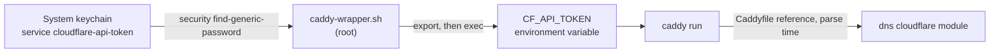

# TLS strategy

Caddy serves HTTPS under two kinds of name. LAN names, such as `your-server.local`, get certificates from Caddy's own CA. The public name, `example.com`, can get a Let's Encrypt certificate through a DNS-01 challenge at Cloudflare. This page explains why each kind of name needs a different method, why Caddy is a custom build, and how the Cloudflare API token reaches Caddy without being written to a file.

## Two kinds of name

| Name | Example | Certificate | Why |
| --- | --- | --- | --- |
| LAN names | `your-server.local`, `localhost`, `192.168.21.10` | Caddy internal CA (`tls internal`) | No public CA issues certificates for `.local` names or private IPs |
| Public name | `example.com` | Let's Encrypt, DNS-01 through Cloudflare | Browsers trust it without extra setup |

A `:443` catch-all site answers any other host name, or a bare IP, with 403. A client must name a site that the Caddyfile knows.

## LAN names: the internal CA

A public CA cannot prove that a requester controls `your-server.local`, because `.local` names exist only on the local network. Caddy's internal PKI solves this: Caddy runs its own root and intermediate CA and signs a certificate for each LAN name.

The cost is trust. Each client must install the root certificate once. The repo ships it as [`caddy-root-ca.crt`](https://github.com/smartwatermelon/mac-server-setup/blob/main/app-setup/templates/caddy-root-ca.crt). The global options set `intermediate_lifetime 90d`, so the intermediate certificate changes less often than Caddy's default.

The CA's keys live in Caddy's data directory, under `pki/authorities/local/`. Deleting that directory creates a new root, and every client then needs the new root. The Caddy page warns about this. See [Caddy](../apps/caddy-README.md).

## The public name: DNS-01 at Cloudflare

Let's Encrypt offers two common challenges. HTTP-01 needs port 80 open to the internet. DNS-01 needs a TXT record at `_acme-challenge.example.com`. The server uses DNS-01 for these reasons:

- No inbound port has to be open for issuance or renewal.
- Cloudflare holds the zone and has an API, so Caddy can create the TXT record itself.

Two timing settings in the `issuer acme` block come from failures on a real server:

- `propagation_timeout -1` turns off Caddy's own check of Cloudflare's name servers. That check sent DNS queries that the network or VPN routing could block.
- `propagation_delay 30s` adds a wait after Caddy creates the record. Without it, Let's Encrypt sometimes checked before the record had propagated, and the challenge failed.

The block also names the production ACME directory with `dir`. Without it, a stale staging account in Caddy's data directory can be used again, and Caddy then issues certificates that browsers do not trust.

Since the move to the Cloudflare Tunnel, browsers reach `example.com` through Cloudflare, and Cloudflare terminates TLS at its edge. The `example.com` site with its DNS-01 certificate stays in the Caddyfile as the rollback path to direct WAN access. See [Tunnel security layers](tunnel-security-layers.md).

## Why Caddy is a custom build

DNS-01 needs a DNS provider module. The Homebrew Caddy binary does not include `caddy-dns/cloudflare`. The documented method downloads a binary that includes the module from Caddy's download API, replaces the Homebrew binary with it, and pins the formula with `brew pin caddy` so that `brew upgrade` does not put the stock binary back.

This is a manual step. `caddy-setup.sh` installs the stock Homebrew Caddy if no binary is present. It does not download the custom build or pin the formula. The procedure is in [Caddy](../apps/caddy-README.md).

## How CF_API_TOKEN reaches Caddy

The Cloudflare API token can edit DNS for the zone, so it must not sit in a file that other accounts can read.

1. The token is in the System keychain. Only root can read it. You add it by hand, at a prompt.
2. The Caddy LaunchDaemon runs `/bin/bash /usr/local/bin/caddy-wrapper.sh` as root. The plist holds no token. Files in `/Library/LaunchDaemons/` are readable by every user.
3. The wrapper reads the token, exports it as `CF_API_TOKEN`, and uses `exec` to replace itself with `caddy run`. The token is in the process environment, not in the argument list.
4. The Caddyfile refers to the token as `{$CF_API_TOKEN}`. The Caddyfile is readable by `operator`, and it holds only the reference.

The syntax matters. Caddy has two forms:

| Form | Replaced | Result for `dns cloudflare` |
| --- | --- | --- |
| `{$CF_API_TOKEN}` | When the Caddyfile is parsed | The real token goes into the module config |
| `{env.CF_API_TOKEN}` | At request time, by HTTP handlers only | The module gets the literal text and Cloudflare rejects it |

The DNS module is TLS configuration, not an HTTP handler, so only the `{$...}` form works. With the other form, the challenge fails with no clear error.

Because Caddy needs the token in its environment, you restart Caddy with `launchctl kickstart`, not `caddy reload` or `caddy start`. A plain `caddy` command does not go through the wrapper and has no token. For the general pattern, see [Credential chain](credential-chain.md).
