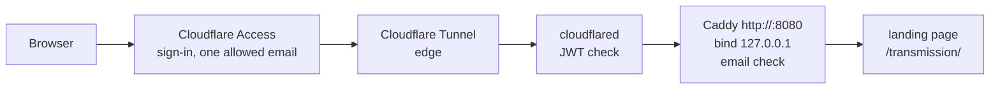

# Tunnel security layers

`example.com` reaches the server through a Cloudflare Tunnel, behind Cloudflare Access. No inbound port is open, and a visitor signs in with Google instead of typing a password into a browser prompt. This page explains each layer that protects that path, what each layer does and does not stop, and why the tunnel site must not serve `/media`.

## The path of a request

cloudflared on the server makes an outbound connection to Cloudflare. Requests for `example.com` come back over that connection, so the home router forwards no port for this path. On the LAN, `your-server.local` still goes straight to Caddy on 443 with the internal CA, as before. See [TLS strategy](tls-strategy.md).

## Why several layers

Each layer stops a different failure. The design does not depend on one setting at Cloudflare staying correct.

| Layer | Where | Stops | Does not stop |
| --- | --- | --- | --- |
| 1. Access policy | Cloudflare edge | Anyone who does not sign in as the allowed email | A change to the policy that allows more people |
| 2. JWT check | cloudflared (`access.required` on the ingress) | Requests with no valid Access token for this application, including after the application is deleted or replaced | A widened policy: every newly allowed visitor gets a valid token |
| 3. Email check | Caddy tunnel site | Any signed-in user other than the allowed email | A client-sent header that Cloudflare fails to replace |
| 4. Drift watchdog | `operator` LaunchAgent, every 15 minutes | Silent changes to the application, policy or ingress | Nothing by itself; it sends email |
| 5. Loopback bind | Caddy tunnel site | Any client that is not on the server | Requests that cloudflared forwards, and local processes on the server |

### 1. Access policy

The Access application for `example.com` allows one identity provider and one reusable policy, and that policy includes exactly one email. This is the main control. All the layers below exist because a person can change it in the dashboard.

### 2. The cloudflared JWT check

The tunnel ingress, set in Cloudflare, sends `example.com` to `http://127.0.0.1:8080` with `originRequest.access.required: true`, the team name `your-team`, and the application's AUD tag. cloudflared then refuses a request that has no valid Access token for that application. The check proves only that Access let the request through. If the policy is widened, the new visitors get valid tokens and pass.

Caddy does not check the JWT a second time. cloudflared already does it.

### 3. The origin email check

The Caddy tunnel site serves its routes only when the `Cf-Access-Authenticated-User-Email` header equals `ACCESS_ALLOWED_EMAIL` exactly. Any other request gets 403. This is the layer that still holds if the policy is widened, because the email is fixed in the Caddyfile on the server, not in the dashboard.

The check depends on Cloudflare setting the header itself. A test on 2026-10-22, through a temporary Access application, sent a forged `Cf-Access-Authenticated-User-Email` header from a signed-in client. The origin received one value, the real signed-in email.

`caddy-setup.sh` refuses an empty or malformed `ACCESS_ALLOWED_EMAIL`, so the check cannot be rendered as a header match on nothing.

### 4. The drift watchdog

`access-policy-watchdog` reads the Access application, the policy and the tunnel configuration from the Cloudflare API every 15 minutes. It compares each one with an exact expected shape, not a list of known bad values, so a setting that Cloudflare adds later also counts as drift. It checks, for example, that `allowed_idps` lists only the one identity provider (an empty list allows every provider, including one-time PIN), that the ingress has exactly the `example.com` rule and a 404 catch-all, and that `warp-routing` is off. With WARP routing on, the tunnel could route traffic into the LAN past both Access and Caddy.

The watchdog cannot block anything. It sends email when the shape changes, when an object returns 404, and when the API cannot be read three times in a row. While the API is unreadable, it leaves open alerts open, so it does not send a false all-clear while the policy may still be wide open.

It runs as an `operator` LaunchAgent, not a root daemon, because the alert mail goes through msmtp with `operator`'s config. Its API token can only read Access and tunnel configuration. See [Credential chain](credential-chain.md).

### 5. The loopback bind

The tunnel site listens on `127.0.0.1:8080` only. No device on the LAN or the internet can connect to it. From off the server, the only way in is through cloudflared, which applies layer 2. A process on the server itself can connect to the port and send any header, so this layer does not protect against local accounts.

## How the Caddy tunnel site is built

The tunnel site is a separate site block, `http://:8080`, and its structure follows from one fact: every request on it comes from loopback, because cloudflared connects from `127.0.0.1`.

- **It does not import `common_config`.** That snippet decides authentication by source IP and treats loopback as local. On the tunnel site it would apply no authentication at all.
- **Its routes sit inside `handle @access_user`.** A catch-all `handle` returns 403. Caddy sorts directives such as `redir` and `reverse_proxy` ahead of `handle`, so a route at site level would run before the email check.
- **It does not use a `route` block.** `route` runs directives in the order written, and `file_server` comes first in the shared routes, so it would answer every path.
- **The access log is a separate snippet.** `log` is a site-level directive and is not allowed inside `handle`.

[`tests/caddyfile.bats`](https://github.com/smartwatermelon/mac-server-setup/blob/main/tests/caddyfile.bats) checks each of these properties.

## Why the tunnel site must not serve /media

On the LAN site, `/media/` proxies to `media-server.py`, a file browser for the whole NAS share. A guard, `@not_local`, returns 403 to any source IP outside the LAN. That guard is keyed on the source IP.

On the tunnel site, every source IP is `127.0.0.1`. The same guard would treat every tunnel request as local and let it through to the whole share. For that reason the `/media` handler is in `common_config` only, and the routes that the tunnel site imports, `site_routes`, do not include it. A comment in the Caddyfile states the rule. On the tunnel site, `/media` falls through to `file_server` and returns 404.

The general rule: any check keyed on the source IP means nothing behind a local proxy. Authentication on the tunnel path must come from the Access identity, not from the network address.

## What happens when a layer fails

- **The policy is widened at Cloudflare.** New visitors pass layers 1 and 2, and layer 3 returns 403 to them. Layer 4 sends email.
- **The Access application is deleted.** Layer 2 blocks every request. Layer 4 reports the 404.
- **A new hostname is routed to `:8080` without Access.** Layer 3 still requires the header with the allowed email. Without Access in front, the repository has not tested whether Cloudflare removes a header that the client sends, so do not rely on layer 3 alone in this case. Layer 4 sends email.
- **cloudflared stops.** Visitors see a Cloudflare error page. The tunnel health watchdog reports it after three failed checks. The LAN site does not change.

For the Cloudflare objects, the token chain, revocation and rollback, see [Cloudflare Tunnel](../components/cloudflare-tunnel.md).
