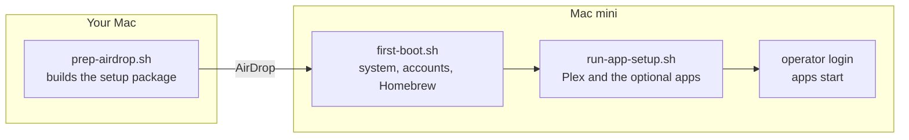
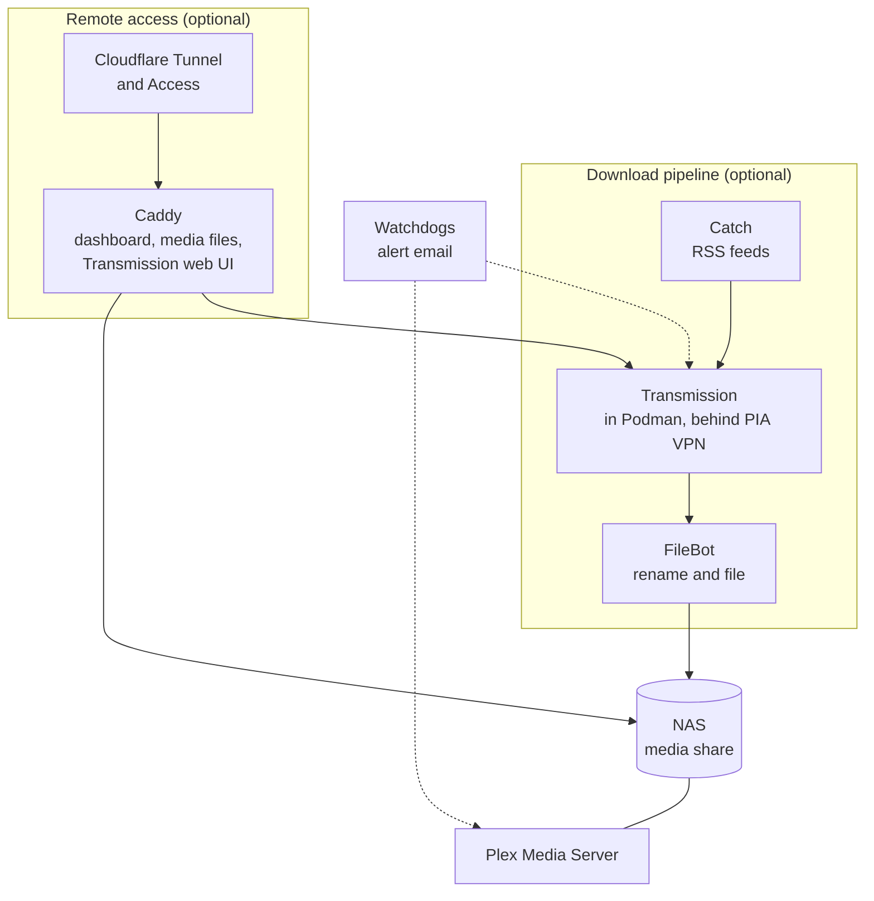

# mac-server-setup

Scripts that turn a fresh Apple Silicon Mac mini into a home media server.
You run one script on your own Mac, one on the Mac mini, and one more to
install the apps. Every script is idempotent, so you can run it again after
a failure.

The server runs Plex for a NAS full of media. Around it, you can add a
download pipeline behind a VPN, a web dashboard with remote access, and
watchdogs that email you when something breaks. Each of those parts is
optional, and the [stack matrix](reference/stack-matrix.md) says what you can leave
out or replace.

[Start here: the get-started tutorial](get-started/index.md){ .md-button .md-button--primary }

## How setup runs

1. **Prep, on your Mac.** `prep-airdrop.sh` reads your config and your
   1Password items, and builds a package with keys and credentials.
2. **First boot, on the Mac mini.** `first-boot.sh` sets up the system, the
   `operator` service account, SSH, and the Homebrew packages.
3. **App setup, on the Mac mini.** `run-app-setup.sh` installs Plex and any
   optional parts you chose. When `operator` logs in, the apps start.

## What runs on the server

## Where to go next

- New install: the [get-started tutorial](get-started/index.md), eight
  pages from a spare Mac mini to the first play in Plex.
- Every config key: the [configuration key reference](reference/config-keys.md).
- Why it is built this way: the [explanation pages](explanation/index.md).
- Which parts you need: the [stack matrix](reference/stack-matrix.md).
- The code: [smartwatermelon/mac-server-setup](https://github.com/smartwatermelon/mac-server-setup).
